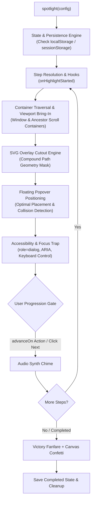

# Spotlight.js

<p align="center">
  
</p>

<p align="center">
  <b>The modern, zero-dependency JavaScript engine for interactive product tours, multi-element spotlights, tour persistence, sound feedback, confetti celebrations, and onboarding checklists.</b>
</p>

<p align="center">
  <a href="https://github.com/Rahulchaube1/-Spotlight.JS/stargazers"></a>
  <a href="https://github.com/Rahulchaube1/-Spotlight.JS/network/members"></a>
  <a href="https://spotlightjs.rahulchaube1.com"></a>
  <a href="https://bundlephobia.com"></a>
  <a href="https://github.com/Rahulchaube1/-Spotlight.JS/blob/main/license"></a>
  <a href="https://buymeacoffee.com/rahulchaube"></a>
</p>

---

## Why Spotlight.js?

Most onboarding and walkthrough libraries today suffer from serious limitations:
- **Heavy runtime bloat**: Dragging in 30kB to 90kB of polyfills, animation dependencies, or external CSS bundles.
- **Broken SPA navigation**: Losing user progress the moment a page reloads, a client-side route changes, or a tab closes.
- **Passive user experience**: Users mindlessly clicking "Next &rarr; Next &rarr; Next" without ever interacting with your actual application.
- **Positioning breaks inside overflow containers**: Popovers misaligning when targets reside inside scrollable panels or fixed dialogs.
- **Rigid design systems**: Popovers that fight modern CSS setups like Tailwind CSS and CSS variables.

**Spotlight.js delivers an ultra-fast, zero-dependency engine in under 5kB.** It provides silky-smooth SVG cutouts, native multi-element spotlighting, automatic local storage tour persistence, zero-dependency Web Audio synthesizers, interactive action gating, and onboarding checklists that integrate seamlessly with your product.

---

## Core Highlights

- **Zero Dependencies**: Pure vanilla TypeScript compiled with zero external runtime packages.
- **Ultra Lightweight**: Just **4.9 kB minified + gzipped** (13.3 kB uncompressed).
- **Tour State Persistence**: Automatically stores progress in `localStorage` or `sessionStorage` with auto-resume across reloads and route changes.
- **Interactive Action Gating (`advanceOn`)**: Require users to perform real tasks (clicking buttons, typing into inputs) before the tour progresses.
- **Multi-Element Spotlighting**: Spotlight multiple elements simultaneously under a single, unified cutout mask.
- **Deep Scroll Container Support**: Intelligent ancestor traversal (`bringInView`) ensures elements inside nested scrollable containers are brought cleanly into view.
- **Full Accessibility (a11y)**: Built-in focus trapping, WCAG `role="dialog"`, ARIA live region announcements, and keyboard shortcuts (`Escape`, `Arrow` keys).
- **Synthesized Web Audio Feedback**: Zero-dependency audio synth producing pleasant harmonic chimes and victory fanfare.
- **Canvas Confetti Particle Engine**: Built-in 120-line physics simulator celebrating completed tours.
- **Visual Tour Builder**: Point-and-click browser authoring mode that generates clean TypeScript code with one click.
- **Onboarding Checklists**: Interactive checklist sidecars and bottom sheets that sync with active tours.
- **Universal Compatibility**: Works out of the box with React, Next.js, Vue, Nuxt, Svelte, Angular, Solid, Astro, and Vanilla JS.

---

## Architecture & Internal Workflow

Spotlight.js operates through an event-driven modular pipeline designed for performance, isolation, and predictability:



### How the Core Systems Work Under the Hood

1. **SVG Cutout Overlay Mask**: Rather than using 4 disjointed `<div>` blocks around an element, Spotlight.js renders an inline SVG overlay with a single compound path (`d="M0,0 H... V... A... Z"`). This mathematically punches rounded transparent cutouts into the dark overlay, ensuring backdrop blur, smooth borders, and element click-through behavior work reliably.
2. **Ancestor Scroll Detection**: The positioning engine inspects parent DOM elements using `getComputedStyle` to identify containers with `overflow: auto` or `overflow: scroll`. When targeting an element, both the parent container and the root window scroll synchronously into alignment.
3. **Action Gating Subsystem**: When `advanceOn` is specified on a step, Spotlight.js attaches scoped listeners to the target element (or a child selector). Once the user fulfills the condition (such as typing into an input or clicking a toggle), the event is dispatched to the step resolver, immediately transitioning to the next step.
4. **Zero-Dependency Web Audio Synth**: Instead of loading `.mp3` or `.wav` sound files over the network, Spotlight.js accesses the native `window.AudioContext`. It instantiates an oscillator with tailored ADSR (Attack, Decay, Sustain, Release) envelopes to generate harmonic chimes (C6 & E6 chord progression) without any network latency.

---

## Installation

```bash
# npm
npm install spotlight.js

# pnpm
pnpm add spotlight.js

# yarn
yarn add spotlight.js

# bun
bun add spotlight.js
```

Or load directly via CDN:

```html
<link rel="stylesheet" href="https://cdn.jsdelivr.net/npm/spotlight.js@latest/dist/spotlight.css" />
<script src="https://cdn.jsdelivr.net/npm/spotlight.js@latest/dist/spotlight.js.iife.js"></script>
```

---

## Quick Start

### 1. Basic Interactive Tour

```typescript
import { spotlight } from "spotlight.js";
import "spotlight.js/dist/spotlight.css";

const tour = spotlight({
  showProgress: true,
  animate: true,
  steps: [
    {
      element: "#welcome-banner",
      popover: {
        title: "Welcome to the App",
        description: "Let's take a quick 30-second tour of your workspace.",
        side: "bottom",
        align: "start"
      }
    },
    {
      element: "#search-input",
      popover: {
        title: "Global Search",
        description: "Press Cmd+K anywhere to find projects, files, and settings.",
        side: "bottom"
      }
    },
    {
      element: "#action-button",
      popover: {
        title: "Create Resource",
        description: "Click here to initialize a new workspace.",
        side: "left"
      }
    }
  ]
});

// Start the tour
tour.drive();
```

---

### 2. Tour Persistence & Auto-Resume (Solving SPA Interruptions)

Never let a page refresh, browser tab switch, or client-side route navigation reset onboarding progress:

```typescript
const tour = spotlight({
  storageKey: "user_onboarding_v1",
  persist: "localStorage", // or "sessionStorage"
  autoResume: true,
  steps: [
    { element: "#step-1", popover: { title: "Step 1", description: "First step." } },
    { element: "#step-2", popover: { title: "Step 2", description: "Second step." } },
    { element: "#step-3", popover: { title: "Step 3", description: "Final step." } }
  ]
});

// Automatically resumes from the last uncompleted step!
tour.drive();

// Helper management methods:
console.log(tour.isCompleted()); // true if user finished the tour
tour.reset();                   // clears stored progress
tour.resume();                  // resumes from the active stored step index
```

---

### 3. Interactive Action Gating (`advanceOn`)

Guide users by having them perform actual actions in your product instead of clicking "Next":

```typescript
const tour = spotlight({
  steps: [
    {
      element: "#signup-input",
      advanceOn: "input", // advances automatically when the user types
      popover: {
        title: "Enter your username",
        description: "Type your desired username to continue.",
        showButtons: ["close"]
      }
    },
    {
      element: "#save-button",
      advanceOn: { event: "click", selector: "#save-button" },
      popover: {
        title: "Save Profile",
        description: "Click this button to persist your preferences."
      }
    }
  ]
});

tour.drive();
```

---

### 4. Multi-Element Spotlighting

Highlight multiple elements together under a unified SVG cutout mask:

```typescript
const tour = spotlight();

tour.highlight({
  elements: ["#sidebar-nav", "#main-content-panel"],
  popover: {
    title: "Connected Panels",
    description: "Every item selected in the sidebar dynamically updates the main canvas.",
    side: "top"
  }
});
```

---

### 5. Sound Feedback & Celebratory Confetti

```typescript
const tour = spotlight({
  sound: true,    // Synthesizes pleasant harmonic chimes on step changes
  confetti: true, // Launches celebratory physics-based confetti on completion
  steps: [
    { element: "#step-a", popover: { title: "First Feature" } },
    { element: "#step-b", popover: { title: "Second Feature" } }
  ]
});

tour.drive();
```

---

## Framework Integration Examples

### React 19 / Next.js (App Router)

```tsx
"use client";

import { useEffect } from "react";
import { spotlight } from "spotlight.js";
import "spotlight.js/dist/spotlight.css";

export function AppOnboarding() {
  useEffect(() => {
    const tour = spotlight({
      storageKey: "nextjs_onboarding",
      autoResume: true,
      sound: true,
      confetti: true,
      steps: [
        {
          element: "#dashboard-metrics",
          popover: {
            title: "Real-time Metrics",
            description: "Monitor user activity and conversion funnels.",
            side: "bottom",
            align: "start"
          }
        },
        {
          element: "#settings-menu",
          popover: {
            title: "Settings & API Keys",
            description: "Manage your credentials and team members.",
            side: "left"
          }
        }
      ]
    });

    tour.drive();
  }, []);

  return null;
}
```

### Vue 3 / Nuxt 3

```vue
<script setup>
import { onMounted } from "vue";
import { spotlight } from "spotlight.js";
import "spotlight.js/dist/spotlight.css";

onMounted(() => {
  const tour = spotlight({
    storageKey: "nuxt_tour",
    autoResume: true,
    steps: [
      { element: "#vue-hero", popover: { title: "Welcome to Nuxt" } }
    ]
  });
  tour.drive();
});
</script>
```

---

## Configuration Reference

| Option | Type | Default | Description |
| :--- | :--- | :--- | :--- |
| `steps` | `DriveStep[]` | `[]` | Array of step configurations to walk through. |
| `animate` | `boolean` | `true` | Whether to animate transitions between steps. |
| `duration` | `number` | `400` | Transition animation duration in milliseconds. |
| `smoothScroll` | `boolean` | `true` | Smoothly scroll targets into viewport center. |
| `allowClose` | `boolean` | `true` | Whether clicking outside or pressing Escape exits. |
| `allowKeyboardControl` | `boolean` | `true` | Enable Arrow keys (`←` / `→`) and `Escape`. |
| `overlayColor` | `string` | `"rgb(0, 0, 0)"` | Base color of the dark backdrop overlay. |
| `overlayOpacity` | `number` | `0.7` | Opacity value of the backdrop overlay (0 to 1). |
| `stagePadding` | `number` | `10` | Extra padding in px around the spotlight cutout. |
| `stageRadius` | `number` | `5` | Border radius in px of the spotlight cutout corners. |
| `storageKey` | `string` | `undefined` | Unique key to persist user tour state in browser. |
| `persist` | `"localStorage" \| "sessionStorage"` | `"localStorage"` | Storage medium for persistent tour progress. |
| `autoResume` | `boolean` | `false` | Automatically resume tour from saved step index. |
| `sound` | `boolean` | `false` | Enable Web Audio synth sound feedback. |
| `confetti` | `boolean` | `false` | Launch particle confetti on tour completion. |
| `popoverClass` | `string` | `""` | Custom CSS class attached to the popover DOM element. |

### Step Configuration Options (`DriveStep`)

| Property | Type | Description |
| :--- | :--- | :--- |
| `element` | `string \| Element \| (() => Element)` | Selector or element reference to spotlight. |
| `elements` | `(string \| Element)[]` | Array of elements to highlight simultaneously. |
| `advanceOn` | `string \| { event: string; selector?: string }` | Action gate to advance the step upon user event. |
| `popover` | `Popover` | Title, description, buttons, position, and styling options. |
| `skipMissingElement` | `boolean` | If true, silently skips this step if the DOM element is not found. |
| `waitForElement` | `number` | Milliseconds to poll/wait for an element before fallback. |

---

## Frequently Asked Questions (FAQ)

### What is the exact bundle size of Spotlight.js?
Spotlight.js is **4.9 kB minified and gzipped** (13.3 kB uncompressed minified). It is compiled with zero runtime dependencies, ensuring maximum speed without degrading Core Web Vitals.

### How does Spotlight.js handle elements inside nested scrollable containers?
Most walkthrough libraries break when an element is inside an `overflow: auto` or `overflow: scroll` container (such as a sidebar, modal, or table). Spotlight.js includes an intelligent ancestor scanner (`bringInView`) that recursively inspects parent elements, computes relative bounding coordinates, and scrolls both the parent container and the browser window smoothly into view.

### What accessibility (a11y) and keyboard features are built in?
Spotlight.js adheres to WCAG standards:
- Popovers render with `role="dialog"`, `aria-modal="true"`, `aria-labelledby`, and `aria-describedby`.
- When a step opens, focus is automatically shifted to the primary action inside the popover via internal focus trapping.
- Keyboard navigation is active by default: `ArrowRight` advances, `ArrowLeft` returns to previous, and `Escape` closes the tour.

### Can I require users to actually perform an action instead of clicking "Next"?
Yes. Use the `advanceOn` property on any step:
```typescript
{
  element: "#invite-input",
  advanceOn: "input",
  popover: { title: "Enter an email to invite" }
}
```
The step will only advance once the user triggers that real event in your application.

### Does Spotlight.js cause Content Security Policy (CSP) issues?
No. Spotlight.js does not use `eval()`, `new Function()`, or inject remote external stylesheets/scripts. Both the Web Audio synthesizer and Canvas confetti are self-contained and run strictly through native browser APIs.

### How does theming work with Tailwind CSS?
Spotlight.js popovers use standard CSS variables (`--spotlight-popover-font-family`, `--spotlight-animation-duration`, etc.) and support custom classes through `popoverClass`. You can style popovers directly with Tailwind utility classes or integrate with custom design systems.

---

## Point-and-Click Visual Tour Builder

Spotlight.js includes a live in-browser tour authoring mode:

```typescript
const tour = spotlight();
tour.startTourBuilder();
```

Click any element on your page, edit titles and descriptions in the floating preview HUD, and export clean, production-ready TypeScript code straight to your clipboard.

---

## Author & Community

Crafted and maintained with care by **Rahul Chaube**:

- **Portfolio**: [rahulchaube1.com](https://rahulchaube1.com)
- **GitHub**: [@Rahulchaube1](https://github.com/Rahulchaube1)
- **LinkedIn**: [linkedin.com/in/rahulchaube1](https://www.linkedin.com/in/rahulchaube1/)
- **Sponsor / Buy Me a Coffee**: [buymeacoffee.com/rahulchaube](https://buymeacoffee.com/rahulchaube)
- **Documentation & Playground**: [spotlightjs.rahulchaube1.com](https://spotlightjs.rahulchaube1.com)

---

## License

MIT Licensed &copy; 2026 [Rahul Chaube](https://rahulchaube1.com). Free and open-source for personal and commercial projects.
