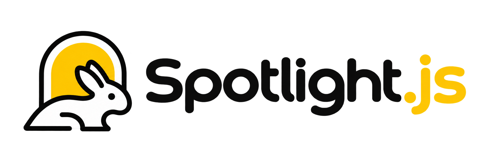

# 🌟 Spotlight.js

<p align="center">
  
</p>

<p align="center">
  <b>The modern, zero-dependency JavaScript engine for delightful product tours, multi-element spotlights, sound feedback, confetti celebrations, and onboarding checklists.</b>
</p>

<p align="center">
  <a href="https://github.com/Rahulchaube1/-Spotlight.JS/blob/main/license"></a>
  <a href="https://Spotlightjs.rahulchaube1.com"></a>
  <a href="https://github.com/Rahulchaube1/-Spotlight.JS"></a>
  <a href="https://buymeacoffee.com/rahulchaube"></a>
</p>

---

## 🚀 Key Features

- **Zero Dependencies**: Lightweight, lightning-fast vanilla TypeScript with zero external runtime bloat.
- **Multi-Element Spotlighting**: Highlight multiple elements simultaneously with a unified, cut-out SVG mask.
- **Web Audio Sound Effects**: Zero-dependency audio synthesizer producing harmonic chimes, clicks, pops, and victory fanfare.
- **Confetti Celebration Engine**: Built-in canvas particle physics engine to celebrate completed tours.
- **Live Visual Tour Builder**: In-browser point-and-click tour authoring mode that generates clean TypeScript code.
- **Built-in Telemetry & Analytics**: Native tracking of step dwell times, skip rates, and completion funnels.
- **Keyboard Cheatsheet Modal**: Glassmorphic shortcut HUD toggleable via the `?` key.
- **Modern Themes**: Out-of-the-box presets including Default, Dark, Cyberpunk Neon, and Frosted Glassmorphism.
- **Full Framework Support**: Works seamlessly with React, Vue, Svelte, Angular, Solid, Next.js, or plain HTML/JS.

---

## 📦 Installation

```bash
# Using npm
npm install @rahulchaube/spotlight.js

# Using pnpm
pnpm add @rahulchaube/spotlight.js

# Using yarn
yarn add @rahulchaube/spotlight.js
```

Or via CDN:

```html
<link rel="stylesheet" href="https://unpkg.com/@rahulchaube/spotlight.js/dist/spotlight.css"/>
<script src="https://unpkg.com/@rahulchaube/spotlight.js/dist/spotlight.js.iife.js"></script>
```

---

## ⚡ Quick Start

```typescript
import { spotlight } from "@rahulchaube/spotlight.js";
import "@rahulchaube/spotlight.js/dist/spotlight.css";

const tour = spotlight({
  showProgress: true,
  animate: true,
  sound: true, // Enables synthesized chime effects!
  confetti: true, // Triggers celebration confetti on completion!
  steps: [
    {
      element: "#welcome-header",
      popover: {
        title: "Welcome to our App!",
        description: "Let us show you around key features in 30 seconds.",
        side: "bottom",
        align: "start"
      }
    },
    {
      element: "#search-input",
      popover: {
        title: "Universal Search",
        description: "Search across projects, documents, and settings instantly.",
        side: "bottom"
      }
    },
    {
      element: "#create-button",
      popover: {
        title: "Create Anything",
        description: "Click here whenever you want to create a new resource.",
        side: "left"
      }
    }
  ]
});

tour.drive();
```

---

## 🛠️ Visual Tour Builder

Spotlight.js features an interactive tour builder mode for rapid prototyping:

```typescript
const tour = spotlight();
tour.startTourBuilder();
```

Click any element on the page to highlight it, set title and description, and export complete TypeScript code ready for production.

---

## 🌐 Community & Author

Crafted and maintained with ❤️ by **Rahul Chaube**:

- 🌐 **Portfolio**: [rahulchaube1.com](https://rahulchaube1.com)
- 💼 **LinkedIn**: [linkedin.com/in/rahulchaube1](https://www.linkedin.com/in/rahulchaube1/)
- 🐙 **GitHub**: [@Rahulchaube1](https://github.com/Rahulchaube1)
- ☕ **Sponsor / Buy Me a Coffee**: [buymeacoffee.com/rahulchaube](https://buymeacoffee.com/rahulchaube)
- 📖 **Documentation**: [Spotlightjs.rahulchaube1.com](https://Spotlightjs.rahulchaube1.com)

---

## 📄 License

MIT Licensed &copy; 2026 [Rahul Chaube](https://rahulchaube1.com). 100% Free and Open Source for personal and commercial projects.
